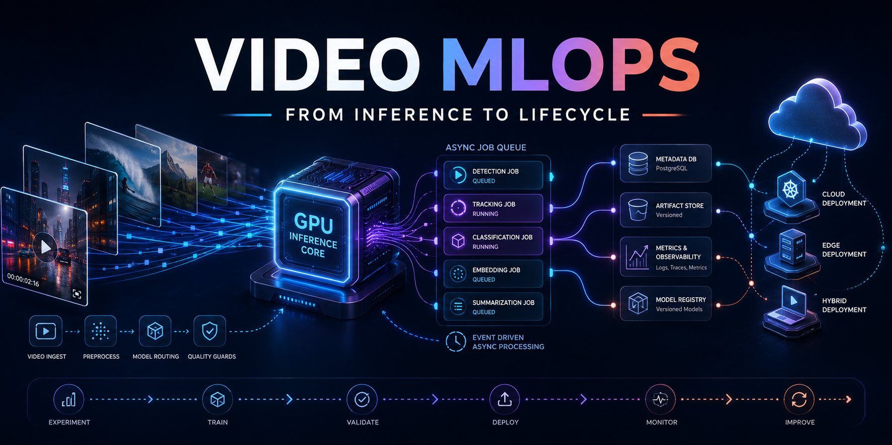
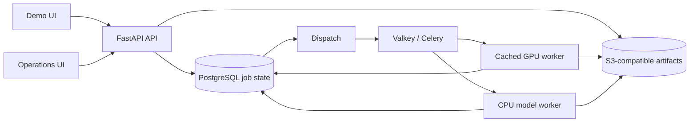

# Video-MLOps: an inspectable inference service

Submit a video, follow its GPU job, and retrieve a summary and category from a small browser UI. Behind that user flow, this **ML infrastructure portfolio** demonstrates durable asynchronous jobs, bounded GPU admission, recovery, model lineage, operations views and an exercised local rollback. The video model is an existing workload used to test the service design, not the main contribution. A separate CPU text-model deployment exercises the same job platform through the API. The demo runs on one local RTX 2080, with no cloud deployment or hosting charges.

Read the [service evolution and setup timeline](docs/SERVICE_EVOLUTION.md) for what each addition solved, how a person's request moves through the system, and which claims have recorded evidence.



## Try the service locally

Use Docker Desktop with GPU support and the [pinned model snapshot in the local Hugging Face cache](docs/GPU_WORKER_LOCAL.md). From the project PowerShell:

```powershell
docker compose -f docker-compose.yml -f docker-compose.gpu.yml up -d --build --wait
```

This uses the locally cached MinIO image and its persistent named volume. The
historical MinIO image may not be anonymously pullable on a fresh machine. To
try the job flow on a fresh machine with no existing service data, use the CI
S3 API test double:

```powershell
$env:VIDEO_S3_ENDPOINT_URL = 'http://minio:9090'
docker compose -f docker-compose.yml -f docker-compose.ci.yml -f docker-compose.gpu.yml up -d --build --wait
```

S3Mock is for a fresh test stack, not the recorded MinIO persistence claims.
Its objects are not a compatible copy of the MinIO volume. Do not switch storage
backends on a stack containing results you need to preserve. The base Compose
stack without the GPU override uses fake video inference and labels its results
as simulated.

Open **http://127.0.0.1:8000/** and submit your own MP4 or the [project-created six-second sample](assets/portfolio/demo_shapes.mp4), which [passed a real GPU submission](reports/demo_shapes_probe.json). Follow its status, then inspect the summary/category, stage timings, model/config lineage and attempt history. The integrated **http://127.0.0.1:8000/operations** page shows readiness, recent jobs and queue state. For host GPU telemetry in the operations page, start the optional [loopback preview](docs/LOCAL_DEMO.md) at port 8080; host-wide readings require its collector.

The approved [CPU text-model deployment](docs/MULTI_MODEL_SERVING.md) is available through `GET /api/v1/deployments` and `POST /api/v1/deployments/text-topic-v1/jobs` with a JSON `text` field. The browser form currently submits videos; the CPU model is demonstrated through the API.

## What the system demonstrates



The API accepts a job before model execution. PostgreSQL owns durable job, attempt and event state; S3-compatible storage keeps input and result artifacts. The dispatcher repairs unpublished or stale queued work. The GPU worker reuses a pinned SmolVLM2-500M model; an independent CPU worker serves a versioned small text model. Admission is bounded separately for GPU and CPU work. See the [model-adapter contract](docs/MULTI_MODEL_SERVING.md), [job lifecycle](docs/JOB_LIFECYCLE.md), [architecture decision](docs/adr/0001-local-inference-demo.md) and [service timeline](docs/SERVICE_EVOLUTION.md).

## Reproduce the checks

From a project PowerShell, create the service-test environment once if it is
missing. Use Python 3.12, Node.js and the Docker CLI. This environment is
separate from the GPU worker container and the original research `uv.lock`:

```powershell
py -3.12 -m venv .venv
& '.\.venv\Scripts\python.exe' -m pip install -r requirements-service-test.txt
```

If `.venv` already exists with the service-test dependencies, keep it. The
following checks do not submit work or change the running stack:

```powershell
& '.\.venv\Scripts\python.exe' -m pytest -q
& '.\.venv\Scripts\python.exe' -m scripts.verify_manifest
node tests/demo_ui.test.cjs
node tests/operations_ui.test.cjs
docker compose -f docker-compose.yml -f docker-compose.ci.yml config --quiet
docker compose -f docker-compose.yml -f docker-compose.gpu.yml config --quiet
git diff --check
```

With the stack running, the next checks submit new jobs. The CPU check works
with either Compose mode; the GPU check requires the real GPU override and the
cached model:

```powershell
& '.\.venv\Scripts\python.exe' -m scripts.deployment_smoke
& '.\.venv\Scripts\python.exe' -m scripts.gpu_service_smoke --video assets/portfolio/demo_shapes.mp4
```

For a fresh fake-worker stack, use the project `.venv`:

```powershell
& '.\.venv\Scripts\python.exe' -m scripts.service_smoke --video assets/portfolio/demo_shapes.mp4 --restart-worker --check-failure --check-storage
```

That script restarts the worker and creates a
deliberately failed job; it expects **fake** video inference. The
[full local acceptance script](scripts/verify_local.ps1) also rebuilds and
changes the stack, takes a PostgreSQL backup when it finds an existing database,
and requires the original development video and transcript by default. Read its
[runbook](docs/JOB_LIFECYCLE.md#local-acceptance) before using it on an existing
deployment. Do not use `docker compose down -v` if you want to keep job data.

## Inspect the evidence

| Claim | Recorded check |
|---|---|
| Rebuilt real GPU serving and model reuse | [Two-job GPU acceptance](reports/gpu_service_smoke_current.json) |
| Model-independent job infrastructure | [CPU text-model job](reports/multi_model_smoke_2026-10-17.json) with persisted result, attempt history and artifact revision; [deployment contract](docs/MULTI_MODEL_SERVING.md) |
| GPU backlog protection | [Concurrent admission burst](reports/admission_demo.json): two accepted, one 429, acceptance resumes after drain |
| Active-worker failure and recovery | [Interruption timeline and attempt history](reports/recovery_demo.json), [incident explanation](docs/INCIDENT_REVIEW_2026-10-17.md) |
| Honest evaluation gate | [Rejected measured candidate](reports/local_demo_gate.json) under a [provisional policy](configs/gates/local-demo.json) |
| GPU and request measurements | [GPU profile](reports/gpu_profile.md), [bounded serving measurements](reports/serving_measurement_smoke.md) |
| Operational release and rollback | [Executed release report](reports/release_demo_20261017105931.json), [candidate probe](reports/release_candidate_20261017105931.json), [rollback probe](reports/release_rollback_20261017105931.json) |
| Remote delivery checks | [Passing GitHub Actions run for the two-deployment version](https://github.com/humma-humma/video-mlops-platform/actions/runs/39071741619): CPU/UI tests and fake-worker Compose with S3Mock; see [CI scope](reports/ci_acceptance_2026-10-17.md) |
| Reproducibility check | [2026-10-18 local check](reports/reproducibility_2026-10-18.md): manifest, Node tests, focused Python tests and Compose configuration passed; full pytest and live Compose were blocked by this session's filesystem/Docker permissions |
| Connected browser review | [Chrome desktop and narrow review](reports/browser_review_2026-10-17.md), including job lineage and live operations |

See [delivery status](reports/delivery_status.md) for dated evidence and limits. The [reliability/release runbook](docs/LOCAL_RELEASE.md) reproduces the controlled worker interruption and operational rollout/rollback sequence. GitHub Actions runs the Python and Node checks and a fake-worker Compose smoke on a fresh runner; real GPU acceptance is separate local evidence.

The [two-minute walkthrough script](docs/WALKTHROUGH_SCRIPT.md) maps each claim to a live screen or saved report for a portfolio recording.

The [offline diagnostic workbench pilot](docs/DIAGNOSTIC_WORKBENCH.md) exports bounded, redacted incident evidence and checks a deterministic diagnosis baseline against report-derived cases, four historical live-job records and a [controlled service-task walkthrough](docs/DIAGNOSTIC_WALKTHROUGH.md). The replay distinguishes storage failure stages and measured preparation/download slowdowns with two abstentions. Its simulated adapter and hand-designed cases are not an independent root-cause benchmark.

## Scope and limitations

This deployment has one host and one GPU. Short bursts establish admission behavior, not sustained capacity or production p95 latency. The gate rejection uses 2.2B experiment reports and does not approve the distinct 500M serving model. GPU usage on the dashboard is device-wide. CI exercises fake inference with an S3 API test double; the real GPU and MinIO checks are local. Python service dependencies use version ranges and some container tags are mutable, so the setup is functionally tested rather than byte-for-byte reproducible from a fresh clone. A recorded walkthrough remains open. AWS and an external restricted-access deployment are deferred; see the [portfolio direction](docs/PORTFOLIO_REFERENCE.md).

The video model and dataset came from an [earlier assignment and research workflow](docs/ORIGINAL_ASSIGNMENT.md). That document preserves its original objective, data instructions, examples and optimization commands; those runs are separate from the serving demo.
