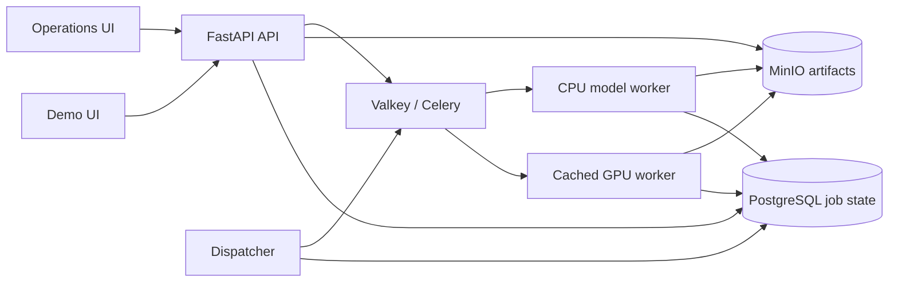

# Video-MLOps: GPU inference reliability demo

An existing video summarization and categorization model provides a concrete GPU workload for an **ML infrastructure portfolio**. The project demonstrates asynchronous serving, durable job history, controlled recovery, resource admission, evaluation gates and local service releases on one RTX 2080. It is a single-host demo, with no additional cloud-hosting spend.


## Try it locally

Docker Desktop with GPU support and the [pinned model snapshot in the local Hugging Face cache](docs/GPU_WORKER_LOCAL.md) are prerequisites. From the project PowerShell:

```powershell
docker compose -f docker-compose.yml -f docker-compose.gpu.yml up -d --build --wait
```

That command reuses the original locally cached MinIO image and its named
volume. On a fresh machine where the historical MinIO registries no longer
allow an anonymous pull, use the S3 API test double from CI to try the UI and
job flow:

```powershell
$env:VIDEO_S3_ENDPOINT_URL = 'http://minio:9090'
docker compose -f docker-compose.yml -f docker-compose.ci.yml -f docker-compose.gpu.yml up -d --build --wait
```

S3Mock is for the fresh-clone smoke path, not the recorded MinIO persistence
claims. Its objects should not be treated as a compatible copy of the MinIO
volume. Do not switch storage backends on an existing stack with results you
need to preserve.

Open **http://127.0.0.1:8000/** and submit your own MP4 or the [project-created six-second sample](assets/portfolio/demo_shapes.mp4), which [passed a real GPU submission](reports/demo_shapes_probe.json). Follow its status, then inspect the summary/category, stage timings, model/config lineage and attempt history. For host GPU measurements alongside readiness, recent jobs and queue state, start the [loopback preview](docs/LOCAL_DEMO.md) and open **http://127.0.0.1:8080/operations**. The service also has a fake-worker mode for CPU-only development; fake results are clearly marked.

The same job platform also exposes an approved [CPU text-model deployment](docs/MULTI_MODEL_SERVING.md). Run `& '.\.venv\Scripts\python.exe' -m scripts.deployment_smoke` against the rebuilt stack to check its separate queue, persisted result, model-artifact revision and attempt history.

## What the system demonstrates



The API accepts a job before model execution. PostgreSQL owns durable job, attempt and event state; MinIO stores input and result artifacts. The dispatcher repairs unpublished or expired work. The GPU worker uses a pinned 500M SmolVLM2 snapshot and reuses its loaded model; an independent CPU worker serves the small text model. Admission is bounded by resource class. See the [model-adapter contract](docs/MULTI_MODEL_SERVING.md), [job lifecycle](docs/JOB_LIFECYCLE.md), [architecture decision](docs/adr/0001-local-inference-demo.md) and [full reference](docs/PORTFOLIO_REFERENCE.md).

## Inspect the evidence

| Claim | Recorded check |
|---|---|
| Rebuilt real GPU serving and model reuse | [Two-job GPU acceptance](reports/gpu_service_smoke_current.json) |
| GPU backlog protection | [Concurrent admission burst](reports/admission_demo.json): two accepted, one 429, acceptance resumes after drain |
| Active-worker failure and recovery | [Interruption timeline and attempt history](reports/recovery_demo.json), [incident explanation](docs/INCIDENT_REVIEW_2026-10-17.md) |
| Honest evaluation gate | [Rejected measured candidate](reports/local_demo_gate.json) under a [provisional policy](configs/gates/local-demo.json) |
| GPU and request measurements | [GPU profile](reports/gpu_profile.md), [bounded serving measurements](reports/serving_measurement_smoke.md) |
| Operational release and rollback | [Executed release report](reports/release_demo_20261017105931.json), [candidate probe](reports/release_candidate_20261017105931.json), [rollback probe](reports/release_rollback_20261017105931.json) |
| Remote delivery checks | [Passing GitHub Actions run](https://github.com/humma-humma/video-mlops-platform/actions/runs/39066600694): CPU/UI tests and fake-worker Compose with S3Mock; see [CI scope](reports/ci_acceptance_2026-10-17.md) |
| Connected browser review | [Chrome desktop and narrow review](reports/browser_review_2026-10-17.md), including job lineage and live operations |

The full local CPU suite passed **159 tests with one optional skip** on 2026-10-17; seven Node UI/dashboard behavior checks and manifest verification also passed. See [delivery status](reports/delivery_status.md) for dated evidence and limits. The [reliability/release runbook](docs/LOCAL_RELEASE.md) reproduces the controlled worker interruption and operational rollout/rollback sequence.

The [two-minute walkthrough script](docs/WALKTHROUGH_SCRIPT.md) maps each claim to a live screen or saved report for a portfolio recording.

## Scope and limitations

This deployment has one host and one GPU. Short bursts establish admission behavior, not sustained capacity or production p95 latency. The gate rejection uses 2.2B experiment reports and does not approve the distinct 500M serving model. GPU usage on the dashboard is device-wide. CI exercises fake inference with an S3 API test double; the real GPU and MinIO checks are local. A recorded walkthrough remains open. AWS and the proposed restricted-access diagnostic workbench are deferred; see the [portfolio direction](docs/PORTFOLIO_REFERENCE.md).

The video model and dataset came from an [earlier assignment and research workflow](docs/ORIGINAL_ASSIGNMENT.md). That document preserves its original objective, data instructions, examples and optimization commands; those runs are separate from the serving demo.
