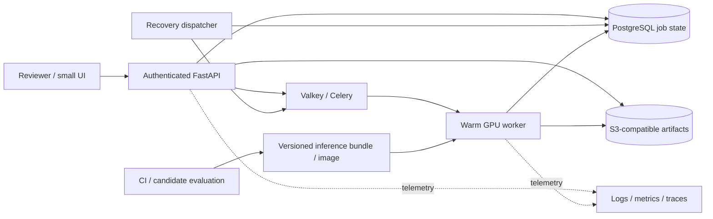

# Video-MLOps: portfolio direction

Agreed with the project owner on 2026-10-10.

**Planning update, 2026-10-12:** see the consolidated
[portfolio reference and implementation roadmap](PORTFOLIO_REFERENCE.md).
It records the immediate local-demo scope and keeps the restricted-access
diagnostic workbench as a deferred future idea.

**Cost decision, 2026-10-10:** proceed locally on the existing GPU with no
additional cloud spend. Build the usable demo and operational evidence now;
defer AWS provisioning. Cloud deployment remains an explicit evidence gap,
not a blocker for the local portfolio. See [LOCAL_DEMO.md](LOCAL_DEMO.md).

## Purpose

Use an existing multimodal video inference workload as the subject of a full
ML infrastructure and deployment project. Demonstrate that the owner can
design, implement, deploy, operate and defend a GPU inference system. The
original model benchmark is background, not the governing project objective.

The portfolio claim is: **I productionized an existing multimodal workload as
an asynchronous GPU inference service, measured its capacity, designed for
failures, and demonstrated a reproducible, observable release lifecycle.**

This document supersedes the priorities in `MLOPS_PLAN.md` and
`PLATFORM_IMPLEMENTATION_PLAN.md` where they conflict. Existing implementation
and evidence remain valid within their documented limits. This is a direction
and acceptance plan, not a claim that the platform is already complete.

## Role alignment

The strongest direct alignment is with SpAItial's ML Inference Engineer and
Dataroots' AI Engineer (MLOps & LLMOps). The two SpAItial infrastructure roles
also value these capabilities, but this project does not prove multi-node
training, distributed checkpointing or petabyte-scale data operations.

Sources reviewed on 2026-10-10:

- [SpAItial ML Inference Engineer](https://uk.linkedin.com/jobs/view/ml-inference-engineer-at-spaitial-ai-4475544414)
- [SpAItial ML & Cloud Infra Engineer](https://jobs.ashbyhq.com/spaitial/1cf5f91a-9f66-48a8-aaee-18a18349785d/)
- [SpAItial ML Systems & Infrastructure Engineer](https://jobs.ashbyhq.com/spaitial/3ba04d10-3097-44f3-9058-003a747944d8/)
- [Dataroots AI Engineer](https://careers.dataroots.io/o/ai-engineer-mlops-llmops)

## Delivery order and acceptance evidence

| Priority | Outcome | Evidence required before claiming completion |
|---|---|---|
| 1 | Reproducible deployed service | Local stack and demo first: versioned images, loopback/private dependencies, access control and deployment smoke. Later AWS evidence requires identity/region/quota/cost preflight, resource inventory and verified teardown. Validate a manual cloud deployment before codifying the proven path as IaC. |
| 2 | Measured serving behavior | Repeatable bounded load runner; input/config/source identity; cold/warm observations; submission and completion latency; queue wait; throughput; failure/timeout counts; GPU/host measurements; justified concurrency limits. |
| 3 | Observable failure and recovery | Job-correlated logs and stage traces; useful metrics/dashboards/alerts; controlled in-flight worker failure; recovery and duplicate-effects evidence; restart-persistent results; incident runbook. |
| 4 | Verified release lifecycle | Executed CI; reproducible dependencies; image/model/config/data lineage; live tracking; rejected candidate; approved release based on an explicit policy; deployment and rollback evidence. |
| 5 | Interview-ready demo | Small submission/status/results UI; sample workloads; linked operational views; architecture diagram; decision records; short walkthrough; recorded fallback. Clearly identify any simulation. |

Work independent of a blocked milestone can proceed, but every claim remains
gated by its own evidence. No numerical SLO, model-quality threshold or cost
estimate is invented to make a gate pass. Separate measured results from
targets and production reference designs.

## Demonstration contract

A reviewer can submit a video, see durable job progression, retrieve the
result and its model/config lineage, inspect operational evidence, and watch
a controlled recovery. The owner can explain queue choice, state ownership,
delivery semantics, GPU limits, storage, security, deployment and cost.

The logical architecture includes implemented and planned components; the
delivery report determines which have actually been verified. The demo is
not a highly available production service. Single-host/single-GPU failure
domains and scaling limits must be explicit.

## Scope and trade-offs

- Keep the existing model and workload. Pause classification tuning and
  further manual category reviews unless required by a release-control test.
- Evaluation demonstrates governance: comparable metrics, traceability and
  rejected promotion when quality is inadequate. Current 8/23 development
  category agreement is not production acceptance.
- Inference engineering remains central: decoding memory, GPU profiling,
  model loading, batching/concurrency, backpressure, throughput and cost.
- Preserve the reserved evaluation set; do not tune on its examples.
- Use AWS as the single cloud and the existing local GPU during development.
  Resolve region, authentication, quota and a session spending ceiling before
  provisioning. Show a concrete resource/cost plan before paid deployment.
- Keep the UI small. Defer training, retrieval, multi-cloud and Kubernetes
  until they answer a measured requirement. Do not add a tool just for a logo.
- Keep local demo, measured cloud deployment and a production reference design
  distinct. Portfolio evidence does not substitute for years of professional
  production ownership requested by the job descriptions.

## Starting state

Local acceptance evidence exists for asynchronous GPU jobs, durable artifacts,
failure records and warm model reuse. Current source has subsequent inference
changes: rebuilt serving-image acceptance is still required. Cloud delivery,
complete observability, executed remote CI and rollback remain open.

The 2026-10-10 environment check found no AWS or Terraform executable. Docker
is installed, but this agent cannot access its engine; the local HTTP API is
live. See [deployment_environment_check.json](../reports/deployment_environment_check.json).
Cloud identity/quota checks have not been performed. Record subsequent
progress in [delivery_status.md](../reports/delivery_status.md).
