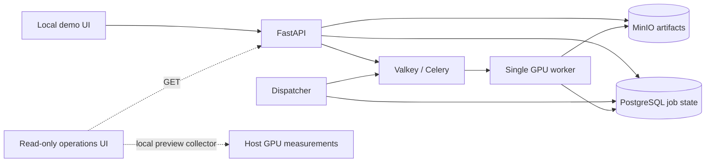
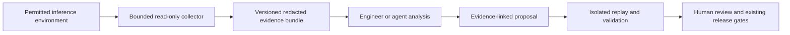

# Video-MLOps: portfolio reference and implementation roadmap

- **Decision date:** 2026-10-12
- **Status:** agreed direction; local acceptance is advancing (latest evidence 2026-10-17)
- **Near-term goal:** finish a working portfolio demo using existing local hardware
- **Future idea:** a diagnostic workbench for GPU inference systems under restricted access

This document consolidates the project purpose, current setup, verified evidence,
inspiration, implementation order and future product idea. It is the planning
reference for subsequent work. The immediate scope below takes precedence over
earlier broader roadmap priorities. Detailed runbooks and raw evidence remain
the authorities for commands and actual execution results.

The implementation snapshot is based on repository inspection on 2026-10-12
and recorded acceptance evidence from 2026-10-09/10. It does not establish that
services are running today. The temporary demo preview was closed after its last
verification. Historical sections of the delivery report can contain superseded
pending states; use the latest dated evidence and the status table here.

**2026-10-17 update:** the current API/GPU image passed a two-job real smoke,
the admission burst enforced a two-job backlog limit, a measured candidate was
rejected under a provisional gate policy, and a controlled active-worker kill
ended in a timeout followed by an explicit successful retry. The [operational
release](../reports/release_demo_20261017105931.json) then passed candidate and
rollback GPU probes, restoring the prior image IDs and preserving both old and
candidate results. [Remote CI](../reports/ci_acceptance_2026-10-17.md) then
passed CPU/UI and fake-worker Compose checks. The [delivery report](../reports/delivery_status.md)
records the connected-browser review and remaining recording work. Older
pending language below describes the original plan, not a fresh status claim.

## Navigation

- [Purpose and positioning](#1-purpose-and-positioning)
- [Decisions and scope](#2-decisions-and-scope-boundaries)
- [Current setup](#3-current-technical-setup)
- [Evidence and limitations](#4-evidence-inventory-and-interpretation)
- [Repository inspiration](#5-inspiration-repositories-and-lessons)
- [Job listings and role alignment](#6-inspiration-job-listings-and-role-alignment)
- [Immediate implementation plan](#7-immediate-implementation-plan-finish-the-local-demo)
- [Definition of done](#8-definition-of-done-for-the-portfolio-demo)
- [Demo sequence](#9-intended-demonstration-sequence)
- [Future diagnostic workbench](#10-future-product-idea-restricted-access-inference-diagnostics)
- [Maintenance and resumption](#11-maintenance-and-resumption-guide)

## 1. Purpose and positioning

The existing video summarization/classification pipeline is the workload used
to demonstrate ML infrastructure, deployment and system design. Model accuracy
optimization is not the governing objective. A reviewer should be able to see
what was built, reproduce its operation, inspect failures and understand the
engineering choices.

The intended portfolio statement, once the corresponding checks are complete:

> A reproducible GPU inference deployment demonstrating reliability,
> observability and safe releases on constrained hardware.

Success means evidence of reliable asynchronous serving; reproducible containers
and artifacts; data/model/configuration lineage; evaluation and promotion controls;
operations and recovery; and documented trade-offs, limitations and costs.
Recorded smoke results alone do not justify claiming sustained capacity,
production readiness or a completed release lifecycle.

The longer-term audience includes ML infrastructure, inference reliability,
research tooling and inference developer-productivity engineers. A local project
can demonstrate relevant reasoning without claiming frontier-lab scale or years
of production ownership. Kernel optimization and distributed training/inference
would require additional evidence beyond this project's current scope.

## 2. Decisions and scope boundaries

| Decision | Consequence |
|---|---|
| Reuse the existing model and video workload | Focus engineering effort on serving, delivery and operations; acknowledge the workload's origin. |
| Use the existing PC and GPU | No additional cloud-hosting expenditure is needed for the agreed local demo. Electricity, disk and hardware remain costs. |
| Finish the portfolio demo before expanding the product | The diagnostic workbench is a future option, not a prerequisite for demo completion. |
| Treat evaluation as release governance | Preserve honest metrics; do not tune labels, thresholds or the reserved set to obtain a passing gate. |
| Keep the architecture small | Defer SLURM, Kubernetes, multi-cloud, new training pipelines and agent infrastructure. |
| Record facts separately from plans | Source implementation, local verification, remote execution and production claims require different evidence. |

AWS was discussed as a possible later deployment target, but provisioning is
deferred. No cloud resources were created in the recorded work. Any later paid
deployment needs a region, authentication, available quota, explicit budget,
resource inventory and teardown plan. This document does not authorize new
spending or external deployment.

## 3. Current technical setup

Repository: `Video-MLOps/efficient-training-of-llms`, currently under
`E:\Others\Video-MLOps\efficient-training-of-llms` on the owner's Windows host.

| Component | Current source/configuration | Responsibility and limits |
|---|---|---|
| FastAPI API | `src/service/api.py` | Upload/validation, idempotent submission, status/result/history, queued cancellation and eligible failed-job retry. |
| PostgreSQL | Compose PostgreSQL 16; Alembic migrations | Durable job, attempt, event and dispatch state. Named volume persistence. |
| Valkey and Celery | Valkey 8; worker concurrency 1 | Task transport and execution. The broker is not the sole durable source of job truth. |
| Dispatcher | Separate process | Retries dispatch and reconciles stuck work independently of GPU availability. |
| MinIO | S3-compatible local object storage | Input and attempt-specific result artifacts. Named volume persistence. |
| GPU worker | `Dockerfile.gpu` and GPU Compose override | Warm model reuse on one GPU; pinned cached 500M model with four sampled frames. |
| Demo UI | Static assets plus `scripts/demo_server.py` | Submission, polling, recent jobs, results/download, attempts/events, timings and lineage. Preview binds to loopback. |
| Operations UI | `/operations` on the preview | GET-only health, job/queue counts, recent jobs and host GPU telemetry. |
| Experiments/gates | Experiment, candidate-gate and tracking scripts | Versioned reports, evaluation comparison and inference-bundle metadata. Deployment is not performed by registration. |
| MLflow | Optional local Compose tracking profile | Tracking and registry integration implemented; live acceptance remains open. |
| CI | `.github/workflows/checks.yml` | CPU/UI checks and fake-stack integration workflow defined; recorded remote execution remains open. |

The original research baseline is SmolVLM2-2.2B. The economical serving demo
uses `HuggingFaceTB/SmolVLM2-500M-Video-Instruct`, pinned to
`7b375e1b73b11138ff12fe22c8f2822d8fe03467`. These are different workloads
and their quality/performance results must not be mixed.

The recorded native profiling environment used RTX 2080 with 8 GiB device
memory, Python 3.10.13, Torch 2.8.0+cu126 and Transformers 4.56.1. Service CPU
dependencies use a separate project virtual environment. GPU Compose mounts a
read-only model cache and uses offline loading. Container and native results
are distinct; the last recorded serving deployment had older source/torchvision
decoding, so acceptance of the current rebuilt GPU image is still required.

This is a single-host demonstration with shared failure domains, not a highly
available service. The diagram intentionally excludes an unverified automated
release controller and distributed tracing backend.

### Job semantics and access

Submission uses `/api/v1/jobs`. Identical input with the same idempotency key
returns the same job; conflicting input returns 409. Keys are scoped to this
service identity, not individual tenants. Attempts and generation fencing guard
against stale completion updates. This does not imply exactly-once execution
or eliminate orphaned artifacts.

The default maximum is three attempts. Certain storage dependency failures
retry with bounded backoff. OOM, invalid output and timeout are not blindly
retried. A hard worker interruption can remain RUNNING until deadline-based
reconciliation: the documented defaults are 840/900-second soft/hard limits
plus a reconciliation allowance. Demonstrations must explain this actual policy.
See [job lifecycle](JOB_LIFECYCLE.md).

Compose publishes ports on loopback. The base stack uses fake inference; the
GPU override disables it. API-key authentication is optional locally and must
be enabled when demonstrating access controls. Non-local configuration rejects
missing/short keys and fake inference. Development database/object-store
credentials, process-local rate limiting and single-service identity are not a
public multi-tenant security design. Media validation and request limits exist;
the preview applies a 64 MiB upload cap. Artifact retention/cleanup remains open.

## 4. Evidence inventory and interpretation

| Capability | Recorded evidence | What remains unproven |
|---|---|---|
| Durable asynchronous service | [Local acceptance](../reports/local_acceptance.json), [service integration](../reports/service_integration_status.md) | Current rebuilt-image acceptance and all failure modes. |
| Artifact persistence | [MinIO status](../reports/minio_integration_status.md) | Complete retention, restore and orphan-cleanup procedures. |
| Real GPU serving/model reuse | [Current-image GPU smoke](../reports/gpu_service_smoke_current.json) | Sustained load and general capacity claims. |
| UI submission and inspection | [Demo acceptance](../reports/local_demo_acceptance.json), [connected-browser review](../reports/browser_review_2026-10-17.md) | Recorded walkthrough. |
| Read-only operations | [Operations acceptance](../reports/operations_acceptance.json) | Durable time-series storage, tested alerts and distributed tracing. |
| Load measurement tooling | [Serving measurement report](../reports/serving_measurement_smoke.md) and [live admission burst](../reports/admission_demo.json) | Representative capacity/SLO evidence. |
| Native GPU diagnostics | [GPU profile](../reports/gpu_profile.md), [JSON evidence](../reports/gpu_profile.json) | Container acceptance, exclusive-device conditions and general performance conclusions. |
| Evaluation and gate contracts | [Experiment lifecycle](EXPERIMENT_LIFECYCLE.md), [recorded provisional rejection](../reports/local_demo_gate.json) and automated tests | Approved 500M candidate and live registry. |
| Operational release | [Candidate/rollback evidence](../reports/release_demo_20261017105931.json) with real GPU probes and preserved hashes | CI-linked immutable artifact and registry promotion. |
| Delivery checks | [Passing remote CI](../reports/ci_acceptance_2026-10-17.md), workflow source and recorded local tests | A real GPU release tied to its CI run and immutable registry artifact. |

Two bounded load runs completed four real jobs at client concurrency two. Run
elapsed times were 75.11 s and 34.13 s; one job waited 53.44 s for its initial
attempt. This illustrates queueing behind one worker. Two observations per run
cannot establish useful production tail latency or sustained throughput.

The direct sample profile recorded summary/category passes of 20.91/6.21 s and
peak process CUDA allocation of 1,541.63 MiB. It did not submit an API job;
the existing 16 job IDs were unchanged. Profiling adds overhead, host GPU usage
includes other processes, and native torchvision decoding does not validate
the current container decoder. Trace/operator artifacts remain local under
`data/outputs/gpu-profile/`.

Historical verification includes 148 passing CPU tests with one skipped native
Transformers check. The operations update separately recorded 15 targeted Python
and six Node behavior checks. These counts overlap earlier coverage and must
not be added into a supposed new full-suite total. Mock-DOM tests are not visual
browser acceptance. No browser was connected during the recorded review.

Development category agreement was 8/23 (34.8%). This is neither platform
reliability nor production model acceptance. The 57-video reserved set was set
aside across 21 categories; historical exposure/provenance still needs checking.
Keep it out of tuning and diagnostic demonstrations until its status is resolved.

## 5. Inspiration: repositories and lessons

The following are inspiration sources, not dependencies or endorsements. Their
documentation and selected workflows were reviewed; their complete deployments
were not independently reproduced. Links were revisited on 2026-10-12 and can
change. No claim is made that the proposed demo sequence is novel.

### sCode: a concrete infrastructure user workflow

[dhimitriosduka1/sCode](https://github.com/dhimitriosduka1/sCode) is a VS Code
extension for submitting, monitoring and managing SLURM jobs. It exposes job
history/logs, queue context and GPU/partition information. Its useful lesson is
a specific audience with a specific operational problem, presented through a
convenient interface.

Video-MLOps currently owns an inference service; sCode interacts with an existing
scheduler. Borrow its clarity of purpose, resource visibility and understandable
job history. A VS Code extension and a SLURM integration are not required for
the local demo.

### Made With ML: a connected model-to-service lifecycle

[GokuMohandas/Made-With-ML](https://github.com/GokuMohandas/Made-With-ML) connects
evaluation, tracking, serving and delivery. Its
[workloads workflow](https://github.com/GokuMohandas/Made-With-ML/blob/main/.github/workflows/workloads.yaml)
posts training/evaluation results to PRs, while its
[serve workflow](https://github.com/GokuMohandas/Made-With-ML/blob/main/.github/workflows/serve.yaml)
defines service rollout. The README also provides rollback instructions.

Borrow the connected lifecycle: a configuration/model change should result in
traceable evaluation, a release decision and an identifiable deployment. These
workflow definitions and instructions do not establish a recorded intentional
candidate rejection, worker-kill recovery or rollback with persisted-result
verification. The project does not need to adopt Ray/Anyscale or add training
to learn from this pattern.

### DuqueOM: operational evidence and honest showcase status

[DuqueOM/ML-MLOps-Portfolio](https://github.com/DuqueOM/ML-MLOps-Portfolio)
publishes incident explanations, architectural decisions and
[deployment/load-test evidence](https://github.com/DuqueOM/ML-MLOps-Portfolio/blob/main/docs/DEPLOYMENT_EVIDENCE.md).
Its [status page](https://github.com/DuqueOM/ML-MLOps-Portfolio/blob/main/PORTFOLIO_STATUS.md)
distinguishes retained evidence from paused cloud infrastructure. Borrow the
incident narrative, linked measurements and explicit cost/status reporting.

Its published load observations concern CPU services, not equivalent GPU queue
protection. Its
[canary ADR](https://github.com/DuqueOM/ML-MLOps-Portfolio/blob/main/docs/decisions/008-argo-rollouts-canary.md)
marks production execution as pending. Consequently, documentation of release
mechanisms must not be presented as independent verification of the full
deploy/rollback demonstration. Multi-cloud Kubernetes breadth is not the model
for this project's immediate budget or scope.

Across the two lifecycle references, parts of the intended demonstration exist,
but the reviewed material did not establish the exact sequence of active-worker
interruption, GPU overload handling, deliberate rejection and rollback with
persisted-result checks. The portfolio value comes from measured execution and
defensible choices, not claiming to invent these practices.

## 6. Inspiration: job listings and role alignment

These are role-design references, not a claim of meeting all hiring requirements.
Listings can close or change. Described mappings are our interpretation of how
the project can supply evidence.

| Reference | Relevant signal | Project implication |
|---|---|---|
| [SpAItial ML Inference Engineer](https://uk.linkedin.com/jobs/view/ml-inference-engineer-at-spaitial-ai-4475544414) | Production APIs, containerized GPU serving, profiling, memory, batching and cold starts | Strongest immediate inference alignment: own the request-to-result path and measure behavior. |
| [SpAItial ML & Cloud Infra Engineer](https://jobs.ashbyhq.com/spaitial/1cf5f91a-9f66-48a8-aaee-18a18349785d/) | Infrastructure audience originally considered | Retain as an audience reference; local deployment does not establish cloud operations. |
| [SpAItial ML Systems & Infrastructure Engineer](https://jobs.ashbyhq.com/spaitial/3ba04d10-3097-44f3-9058-003a747944d8/) | Systems/infrastructure audience originally considered | Show state ownership, resource limits and failure reasoning; do not claim multi-node expertise from one GPU. |
| [Dataroots AI Engineer, MLOps & LLMOps](https://careers.dataroots.io/o/ai-engineer-mlops-llmops) | Deployment pipelines, testing/releases, lifecycle/versioning, observability and cloud experience | Complete the evaluation-to-release story and explain the remaining cloud gap. |
| [OpenAI Productivity, Inference Runtime](https://openai.com/careers/software-engineer-productivity-inference-runtime-san-francisco/) | Deploy gates, regression detection, reliable validation, failure triage, rollout safety and developer tooling | Particularly close conceptual fit for the future diagnostic workbench and current release evidence. |
| [Anthropic Inference Engine Performance](https://job-boards.greenhouse.io/anthropic/jobs/5418323008) | Profiling, host/device behavior, batching, memory/state reuse and hypothesis-driven performance engineering | Borrow the measurement discipline; the local demo does not establish engine-level or multi-accelerator expertise. |
| [Anthropic Inference Systems Performance](https://job-boards.greenhouse.io/anthropic/jobs/5224564008) | Cross-layer investigations, correctness evaluation, observability and quantitative findings across serving components | Strong future diagnostic-tool alignment: explain evidence across layers and propose testable changes without owning every component. |

The two SpAItial Ashby pages returned JavaScript-only content during this
document's refresh. Their titles/links are retained from the earlier direction
discussion; detailed requirements were not freshly reverified. The inference
listing was readable on LinkedIn. The official
[SpAItial careers page](https://spaitial.ai/careers) is the starting point for
checking current openings. Anthropic's engine and systems listings were read
for their profiling, resource-management, correctness and investigation themes;
its [careers board](https://www.anthropic.com/careers/jobs) also distinguishes GPU
and research-tooling roles. These references are not a full requirements audit
or an assessment of candidate eligibility.

The local portfolio can demonstrate relevant skills, but it does not substitute
for professional production experience or prove large-scale performance. Video
completion latency is also not a measurement of streaming TTFT/TBT; instrument
those explicitly only if a future workload requires them.

## 7. Immediate implementation plan: finish the local demo

Work proceeds in the order below, with dependency-free documentation or UI work
allowed in parallel in time. Completion is based on saved evidence, not elapsed
effort. Commands that rebuild, submit workloads or interrupt workers belong to
the controlled demo environment, never an unrelated active workload.

### Phase A: establish a reproducible serving release

Inspect the current source/image mismatch and preserve the existing database
and artifacts. Rebuild the current CPU/GPU stack, record image identities,
dependency versions, pinned model revision and effective configuration, then
run the existing service/storage/GPU acceptance checks. Verify the current
decoder and warm model reuse rather than inheriting old acceptance claims.

Pin release artifacts by immutable identity; current floating infrastructure
image tags are a reproducibility gap. Document the tested host prerequisites,
cache preparation and both fake and real-GPU paths. Verify the instructions
from a clean checkout/environment when available.

**Exit evidence:** current-image acceptance report, reproducible configuration,
source/image/model identity and working UI/API result inspection. Existing
results remain readable. See [local setup](ARTIFACT_C_LOCAL.md),
[GPU setup](GPU_WORKER_LOCAL.md) and [local demo](LOCAL_DEMO.md).

### Phase B: demonstrate one active-worker failure and recovery

Create a controlled run with a known development sample, capture its job ID and
confirm it is RUNNING before interrupting its worker. Capture detection and
reconciliation times, attempt history and persisted artifacts. Follow the actual
policy: if the job becomes FAILED and requires an explicit retry, show that
rather than describing it as automatic resumption. Restart, recover or retry
as appropriate, then verify the final state and result.

Any shorter demonstration deadlines must be explicit test configuration and
compatible with the expected inference time. Separately validate stale-result
fencing and duplicate dispatch effects; use isolated tests when a live stale
worker is impractical. Do not equate those tests with live distributed evidence.

**Exit evidence:** repeatable failure script/runbook, ordered event timeline,
observed recovery duration, outcome verification and limitations. Persistence
after an already-completed job restart remains a separate test.

### Phase C: measure load and demonstrate resource protection

Use the existing bounded runner and a small development sample mix with known
durations/input hashes. Compare cold/warm conditions and client concurrency
while keeping worker concurrency fixed until measurements justify a change.
Record submission latency, queue wait, completion latency, failures/timeouts,
observed throughput and GPU/host measurements. Avoid competition with unrelated
GPU work or explicitly record contention.

API request-rate limits are not a bound on accepted queued work. Define and
implement a measured admission limit if queued jobs can grow without bound;
make its check atomic under concurrent submission and return a documented
rejection/backoff response. Demonstrate recovery after load stops.

The present closed-loop runner is useful for bounded experiments but slows its
offered load when completions slow. Use a strictly capped burst or controlled
arrival schedule if needed to verify overload; retain job journaling and cleanup
discipline. Do not claim realistic tail latency from tiny samples.

**Exit evidence:** measured operating envelope, justified concurrency/admission
policy, rejection behavior and repeatable overload/recovery report. No invented
SLO or jobs-per-second target is required.

### Phase D: execute candidate rejection, deployment and rollback

Run the defined CI and retain a link to its result. Build an immutable inference
bundle referencing image, model/processor revision, prompt/taxonomy/config and
evaluation inputs. Define a reviewed policy against an honest comparable
baseline; a smoke report cannot be relabeled as a quality-qualified candidate.

Demonstrate one rejected candidate and its explicit reason. A deliberately
invalid or regression fixture may exercise the gate, but must be labeled as a
demonstration fixture rather than a measured model experiment. Complete live
tracking/registry acceptance with a real qualifying candidate before claiming
model-quality promotion. If no candidate meets the policy, record the rejection
and keep quality promotion open rather than weaken the gate.

For the operational release exercise, distinguish a service release validated
against a documented demo contract from model-quality promotion. Deploy a
versioned service bundle, verify health and a known sample, drain work, roll back
to a compatible prior release and verify both old persisted results and new
execution. Retain additive database schema where possible; rollback must not
use destructive volume deletion or blindly downgrade lifecycle tables.

**Exit evidence:** CI run, candidate/gate record, bundle and image identity,
deployment observations, measured rollback outcome and persisted-result checks.
See [experiment lifecycle](EXPERIMENT_LIFECYCLE.md) and
[migration cautions](JOB_LIFECYCLE.md).

### Phase E: package the reviewer experience

Finish visual browser review when a surface is connected. Provide a clearly
licensed/self-created demo sample, screenshots, architecture diagram and a short
recording that includes a useful failure/release sequence. Reuse the existing
operations page and job inspection before adding more UI. Show saved long-running
evidence when a live interview cannot wait through recovery deadlines.

Rewrite the README around purpose, contribution, quick start, current status and
evidence. Preserve attribution while moving the original optimization assignment
to background documentation. Consolidate contradictory historical status text.
Add concise decision records on queue/state ownership, GPU concurrency, storage,
local deployment, access and cost. Add a runbook for the demonstrated incident.

**Exit evidence:** a reviewer can follow the story without the owner narrating
every setup detail; saved evidence remains usable when the GPU host is offline.
The recording is identified as historical, not a live hosted service.

## 8. Definition of done for the portfolio demo

- [x] Current rebuilt serving images pass CPU/storage/GPU acceptance.
- [x] A known sample produces an inspectable real result with versioned lineage.
- [x] Active-worker interruption has a recorded, reproducible recovery outcome.
- [x] Bounded burst and admission behavior demonstrate a justified local resource limit; sustained capacity remains open.
- [x] A rejected candidate has an inspectable provisional gate decision with honest provenance.
- [x] A versioned local operational release and compatible rollback are executed.
- [x] Persisted results survive the demonstrated upgrade/rollback sequence.
- [x] CI execution is linked; simulated and real checks are distinguished.
- [x] UI receives connected-browser visual review; architecture, setup and incident runbooks agree.
- [ ] A short recording and evidence index support offline review.
- [ ] Cloud, scale, model-quality and security limitations are explicit.

Full OpenTelemetry deployment, Prometheus/Grafana retention and production
alerting are useful extensions, but are not prerequisites for completing this
bounded demo. If implemented, start with one operational question and one tested
alert. Do not present current counters as durable metrics or GPU profiler traces
as distributed request tracing.

## 9. Intended demonstration sequence

1. Show architecture and effective release identity, then submit a known sample.
2. Inspect job status, result, timings, attempts and model/configuration lineage.
3. Present the controlled active-worker interruption and its recovery evidence.
4. Show bounded load, queue growth/admission behavior and GPU measurement scope.
5. Inspect a rejected candidate and the policy reason, then the accepted
   operational release and rollback evidence, including persisted results.

The demonstration may combine a short live segment and clearly labeled recorded
evidence. It is not necessary to rerun every failure or expensive evaluation in
every interview. The reviewer should be able to trace each claim to its artifacts.

## 10. Future product idea: restricted-access inference diagnostics

**Status: bounded offline pilot, isolated service-task challenge, live MinIO outage and damaged-video GPU incident recorded 2026-10-18; the broader product remains deferred.**
The [pilot runbook](DIAGNOSTIC_WORKBENCH.md) documents a read-only evidence exporter,
recorded incidents, a controlled fault/latency replay and a deterministic
evaluation. It does not establish diagnosis quality on independent incidents or
grant an agent access to any environment.
Feasibility, ROI and ETA analysis (2026-10-12):
[DIAGNOSTIC_WORKBENCH_FEASIBILITY.md](DIAGNOSTIC_WORKBENCH_FEASIBILITY.md).

Potential positioning:

> An evidence-driven diagnostic workbench for GPU inference systems,
> usable by engineers and agents under restricted access.

The user is an inference/ML infrastructure engineer investigating a stalled job,
latency regression, memory failure or suspicious release with limited production
permissions and incomplete telemetry. The video service becomes the first real
test environment; later adapters could serve other inference deployments or
permitted SLURM environments.

The product would help collect and interpret evidence, construct competing
hypotheses and validate proposed changes. It would not claim to reproduce
frontier-scale infrastructure locally or bypass restricted environments.

### Proposed implementation stages

| Stage | Deliverable | Validation requirement |
|---|---|---|
| F1: portable evidence | Export timestamped job/attempt events, selected logs, metrics, release/config lineage and provenance into a bounded versioned bundle | Redaction, schema compatibility, hashes, missing-evidence markers and offline import work without production access. |
| F2: diagnostic cases | Build timelines and deterministic comparisons for queue saturation, worker interruption, preprocessing regression and memory pressure | Known injected causes, realistic alternative hypotheses and reproducible ground truth. |
| F3: proposals and replay | Produce a configuration diff/patch with evidence, expected effect, risk, next experiment and rollback procedure | Isolated execution compares the proposal with baseline; no production mutation. |
| F4: optional agent interface | Typed operations such as `inspect_job`, `compare_releases`, `get_incident_bundle` and `propose_change` | Authorization boundaries, output/resource limits, audit records, adversarial log handling and abstention tests. |
| F5: additional backend | One validated inference or SLURM adapter | Real authorized integration evidence; mocks alone are not live scheduler acceptance. |

Start with deterministic evidence extraction/comparison and offline bundles.
An LLM is optional; no paid API is needed to establish the tool's core value.
If agent reasoning is later added, retain a deterministic baseline and measure
whether the agent improves diagnosis rather than merely producing plausible prose.

An example diagnostic output would identify unchanged queue wait, increased
preprocessing time and a decoder dependency change, then propose comparing both
versions against the same input before raising worker concurrency. It should
cite the exact observations and identify missing evidence. High device-wide GPU
usage by itself is insufficient to diagnose the model worker.

### Access boundary and evaluation

The future agent consumes scoped evidence and produces proposals. It receives
neither unrestricted shell access nor deployment/scheduler administrator
credentials. Enforce permissions in the collector/tool implementation, not only
in the agent prompt. Collect only authorized fields; logs, traces and configs can
contain sensitive material. Treat instructions embedded in those artifacts as
untrusted data. Read-only collection still needs timeout, rate, size and query
limits to protect the monitored service.

SLURM integration must respect site/user authorization. SchedMD's
[JWT guidance](https://slurm.schedmd.com/jwt.html) discusses proxies for enforcing
site-specific trust policies; an agent adapter is not permission to bypass those
policies. Offline exported evidence is a valid first integration when live
access is unavailable.

Evaluate cause identification, evidence citation accuracy, useful next
experiments, inappropriate-confidence rates, abstention under missing evidence,
and authorization violations. Keep held-out incident variants to test
generalization; do not expose the injected answer in the analyzer's bundle.
Report single-host real cases separately from synthetic multi-node scenarios.
Never fabricate diagnosis-accuracy or time-saved claims.

Promotion of this concept into active work requires completion of the current
demo, several reproducible incidents with meaningful diagnostic difficulty,
evidence that the bundle/analysis workflow is useful, and a separately agreed
scope. Kernel, NCCL/communication and multi-GPU claims need real additional
measurements; a local simulation is only a labeled test fixture.

## 11. Maintenance and resumption guide

Start with this document and the latest entries in
[delivery status](../reports/delivery_status.md). Verify repository state,
source/image identities and service availability before relying on historical
results. Preserve existing data and unrelated working changes. Do not automatically
start the preview, submit jobs or run failure injection just to read the project.

| Need | Reference |
|---|---|
| Earlier direction and role discussion | [PORTFOLIO_DIRECTION.md](PORTFOLIO_DIRECTION.md) |
| Local stack and prerequisites | [ARTIFACT_C_LOCAL.md](ARTIFACT_C_LOCAL.md), [GPU_WORKER_LOCAL.md](GPU_WORKER_LOCAL.md) |
| Demo start/stop and walkthrough | [LOCAL_DEMO.md](LOCAL_DEMO.md) |
| Read-only dashboard and profiling | [OPERATIONS.md](OPERATIONS.md) |
| Durable jobs, retries, migrations | [JOB_LIFECYCLE.md](JOB_LIFECYCLE.md) |
| Evaluation/tracking/promotion tooling | [EXPERIMENT_LIFECYCLE.md](EXPERIMENT_LIFECYCLE.md) |
| Load runner and measurement definitions | [SERVING_MEASUREMENTS.md](SERVING_MEASUREMENTS.md) |
| Local architecture/cost decision | [ADR 0001](adr/0001-local-inference-demo.md) |
| Deferred AWS preparation | [AWS_DEPLOYMENT_READINESS.md](AWS_DEPLOYMENT_READINESS.md) |

The existing full acceptance entry point is `scripts/verify_local.ps1`; it
installs dependencies, backs up an existing database, rebuilds/switches stack
modes and runs workload checks. It is an active verification operation, not a
read-only status command. Review the runbook and prerequisites before execution.

For later updates, record the date, source/image/bundle identities, actual
commands, observed outcomes, artifact paths and limits. Mark milestone completion
only when its exit evidence exists. Refresh external links when targeting a
specific application. The next implementation milestone is **Phase A**, followed
by the controlled recovery demonstration in **Phase B**.
