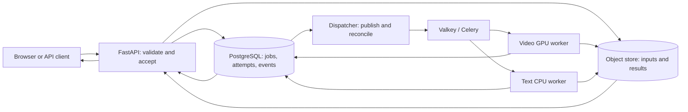

# From video experiment to inference service

This is the story of a service people can use, not a claim that the video model was invented here. The project began with an existing video summarization and categorization pipeline. That pipeline supplies a realistic GPU workload; the engineering objective is to make inference accessible, recoverable, observable and releasable on a small budget. A person can now submit a video, follow a job, retrieve its result and inspect what happened. A second, CPU text-model deployment shows that the job platform is not tied to the video model.

The dates below mark repository milestones, not continuous operation or production launch. Links point to implementation notes and recorded checks. Earlier reports sometimes describe work that was pending *at the time*; the latest evidence and limitations are summarized here.

## Timeline: each addition and the problem it solved

| When | Previous experience or gap | Addition | What changed for a user or operator |
| --- | --- | --- | --- |
| **January 2026: research pipeline** | Video inference was an experiment run from scripts and notebooks. Configuration and results served model comparisons, but there was no request endpoint, job ID, durable status or way for another person to use it as a service. | Configurable inference, video decoding and benchmark runs for the original assignment. The [original assignment](ORIGINAL_ASSIGNMENT.md) and Git history preserve this starting point. | We had a real workload and input data to deploy. Running an experiment was still different from serving a request. |
| **September 2026: service foundation** | A long GPU operation could not be safely held inside one synchronous web request, and local output files did not provide a shared source of truth. | The [platform foundation](../README.md) added a FastAPI API, Celery/Valkey workers, PostgreSQL job records, S3-compatible input/result storage, Docker Compose, a pinned GPU-serving path, migrations and service checks. | A caller could submit work, get a job ID immediately, check status later and retrieve a stored result. The API and worker became separate processes. |
| **October 2026: a usable local demo** | An API alone made the system hard to try and hard to explain. A successful result did not reveal queueing, model identity or failures. | A [browser UI](LOCAL_DEMO.md) added upload, status polling, recent jobs, result download, timings, lineage and attempt/event history. A read-only [operations page](OPERATIONS.md) exposed readiness, queue/job counts and host GPU telemetry. | A reviewer could use a small page rather than write a client, reload and reopen a persisted job, and see the service's internal state. The UI remains video-focused; the text deployment is available through the API. |
| **October 17: bounded, durable job lifecycle** | Broker delivery and a running worker alone could lose a publication, duplicate a task or leave an interrupted job in an unclear state. An unlimited backlog could hide single-GPU overload. | The [job lifecycle](JOB_LIFECYCLE.md) added idempotency, database-backed attempts/events, a dispatcher that repairs unpublished or stale queued work, atomic task claims, generation fencing, bounded retries and resource-class admission. | Repeating a request with the same key and input returns its job; a conflicting input gets 409. A full GPU backlog returns 429 with `Retry-After`. A failed job has an understandable history and can be retried when eligible. This is not exactly-once execution or instant recovery. |
| **October 17: real failure and load evidence** | Reliability features existed in code, but a reviewer could not tell how the deployed system behaved under interruption or contention. | The [admission burst](../reports/admission_demo.json) accepted two real GPU jobs, rejected a third, then accepted new work after drain. In the [controlled worker interruption](../reports/recovery_demo.json), the active attempt reached its deadline, failed as `timeout`, and an explicit retry succeeded on attempt 2. | The limit protects the one-GPU service from an unbounded queue, and job history explains the observed recovery. The interruption does **not** demonstrate automatic, immediate resumption of a killed GPU task. |
| **October 17: evaluation and release controls** | A new configuration or image could be deployed without a recorded comparison or a way to prove that old results survived a rollback. | Versioned experiment reports and a [candidate gate](EXPERIMENT_LIFECYCLE.md) capture input/model/config hashes and reject incomplete or regressed candidates. A [local release exercise](LOCAL_RELEASE.md) deployed a candidate, ran a real GPU job, restored the prior API/dispatcher/worker image IDs and rechecked old and new result hashes. | An operator can show a rejected unsuitable candidate and a reversible *operational* rollout. The demonstrated gate concerns measured 2.2B experiments; it does not approve the distinct 500M serving model. The rollback was local, with schema-compatible images, not a production promotion system. |
| **October 17: delivery and browser verification** | Passing local tests did not show that a fresh CI runner could build the stack, and mocked UI tests did not establish the visible layout. | GitHub Actions added Python/Node checks and a Compose service smoke; fresh-runner object storage uses an S3 API test double because the historical MinIO image could not be anonymously pulled. The [connected Chrome review](../reports/browser_review_2026-10-17.md) checked the desktop and narrow UI, persisted job detail and operations view. | A reviewer can inspect reproducible remote checks and an actual browser review. CI's fake worker and S3Mock do not substitute for the separate [local real-GPU and MinIO evidence](../README.md#inspect-the-evidence). A recorded walkthrough is still open. |
| **October 17: shared model-serving platform** | The first service design was shaped around one VLM. Adding a CPU model through the GPU queue would waste GPU capacity and obscure which deployment produced a result. | [Reviewed deployment adapters](MULTI_MODEL_SERVING.md) introduced `video-summary-v1` and `text-topic-v1`, separate GPU/CPU queues, resource-class limits, deployment identity on jobs, and model-artifact lineage. The [CPU smoke](../reports/multi_model_smoke_2026-10-17.json) recorded a successful persisted job and matching artifact hash. | API users can list approved deployments and submit text to the CPU model while video retains its old endpoint. Both use the same job/history/result contract. The small text classifier proves routing and persistence, not useful predictive quality or arbitrary model upload. |

## What a person does today

For the video demo, open `http://127.0.0.1:8000/`, choose a small MP4 (the [six-second sample](../assets/portfolio/demo_shapes.mp4) is included), optionally add a transcript, and submit. The service validates the input and accepts the job before inference completes. The page follows `QUEUED` and `RUNNING` to a terminal state, then shows the summary and category, downloadable result, stage timings, model/configuration lineage, attempts and correlated events. Recent jobs can be reopened after a page reload. The separate `/operations` page shows service readiness, recent jobs, queue state and host GPU activity; it can be inspected without submitting a new video. See the [walkthrough](LOCAL_DEMO.md) and [recorded real sample probe](../reports/demo_shapes_probe.json).

An API client can instead list approved deployments with `GET /api/v1/deployments`. `POST /api/v1/jobs` remains the video submission route; `POST /api/v1/deployments/video-summary-v1/jobs` is its explicit alias. `POST /api/v1/deployments/text-topic-v1/jobs` accepts JSON such as `{"text":"example"}`. All deployments use `/api/v1/jobs/{id}` for status and `/result`, `/attempts` and `/events` for details. The text model currently has no dedicated browser submission form. Its [smoke script](../scripts/deployment_smoke.py) demonstrates the API path.

The user-visible contract is intentionally asynchronous: **acceptance means the request is recorded, not that inference has succeeded**. A caller should keep the returned job ID or use an `Idempotency-Key` when a submission might be repeated. Failed jobs expose a reason and prior attempts; only eligible failures can be retried, and queued jobs can be cancelled. A running GPU kernel is not cancelled by the queued-job cancellation route.

## How a request moves through the service



PostgreSQL is the durable authority for job state. The object store keeps uploaded inputs and attempt-specific result artifacts. Valkey/Celery transports tasks; it is not the only record that a job exists. The dispatcher publishes accepted work and reconciles certain jobs that were not published or stayed queued. A worker claims an attempt in the database, reads the input, loads or reuses its model, writes a result artifact and records completion and events. Atomic claims and attempt generations prevent a duplicate or late completion from replacing the accepted job state. They do not promise exactly-once inference or automatic cleanup of every orphaned object. These semantics are specified in [Durable job operations](JOB_LIFECYCLE.md).

The real video worker runs a pinned SmolVLM2-500M snapshot on the local GPU and reuses a loaded model across jobs. The separate CPU worker serves a small versioned Naive Bayes text artifact. Deployment ID, model revision or artifact hash, input hash, timings and trace ID are attached to real results so an operator can answer **which workload, model and attempt produced this output**. The operations page and `/metrics` help explain queue pressure and failures; device-wide GPU measurements are not per-request GPU accounting, and JSON trace correlation is not a distributed tracing backend.

## Reproduce the setup and its evidence

The intended inexpensive deployment is a single Docker Desktop host with an NVIDIA GPU and a locally cached, pinned video model. From the project PowerShell, after following the [GPU prerequisites](GPU_WORKER_LOCAL.md):

```powershell
docker compose -f docker-compose.yml -f docker-compose.gpu.yml up -d --build --wait
```

This starts PostgreSQL, Valkey, object storage initialization, migrations, API, dispatcher and the GPU/CPU workers. Open `http://127.0.0.1:8000/`. The base Compose file alone uses **fake video inference** for CPU-only development; its results are marked simulated. On a fresh machine, the historical MinIO image may be unavailable for anonymous pull. The [README setup](../README.md#try-it-locally) explains the S3Mock override for trying the workflow, with the important distinction that it does not reproduce the recorded MinIO persistence check. Keep existing named volumes if stored results matter; `docker compose down -v` deletes them.

The shortest live checks are `python -m scripts.service_smoke` for async submission, stored result, restart and failure behavior; `python -m scripts.gpu_service_smoke` for two real GPU jobs and model reuse; and `python -m scripts.deployment_smoke` for the CPU deployment. Use the command details and prerequisites in the [README](../README.md), [GPU guide](GPU_WORKER_LOCAL.md) and [model-serving guide](MULTI_MODEL_SERVING.md). The [full local verification script](../scripts/verify_local.ps1) covers CPU/migration tests, manifest integrity, fake-stack behavior and real GPU checks. The [reliability/release runbook](LOCAL_RELEASE.md) gives the deliberate interruption and rollback sequence. Saved reports let a reviewer examine the observations even when this one-host demo is offline.

The remote [GitHub Actions checks](https://github.com/humma-humma/video-mlops-platform/actions/runs/39071741619) passed for the two-deployment implementation: CPU/UI tests and a fake-worker Compose integration path. Real CUDA, the local MinIO volume, browser layout and the controlled release were checked separately. These are distinct pieces of evidence, not one end-to-end production deployment.

## What is finished, and what remains a boundary

The current result is a working **local, single-host inference service and portfolio demonstration**: video submission through a UI, a second model through the API, durable asynchronous jobs, bounded GPU admission, inspectable recovery, lineage, operational views, recorded release/rollback and remote delivery checks. The serving model is the test vehicle for those ML infrastructure choices.

It is not a public multi-tenant service or a scale benchmark. The Compose configuration uses local development credentials and loopback ports; API-key support is optional locally, and rate limiting is per API process. One host remains a shared failure domain. There is no cloud deployment, high availability, autoscaling, long-term telemetry/alerts, automated artifact retention, arbitrary uploaded model execution or task-independent model-quality gate. The tiny CPU model has no quality claim. The 2.2B evaluation rejection does not certify the 500M video serving bundle. A portfolio walkthrough recording and a CI-linked immutable release remain future delivery improvements. These limits are deliberate so the demo's claims stay narrower than its ambitions.
